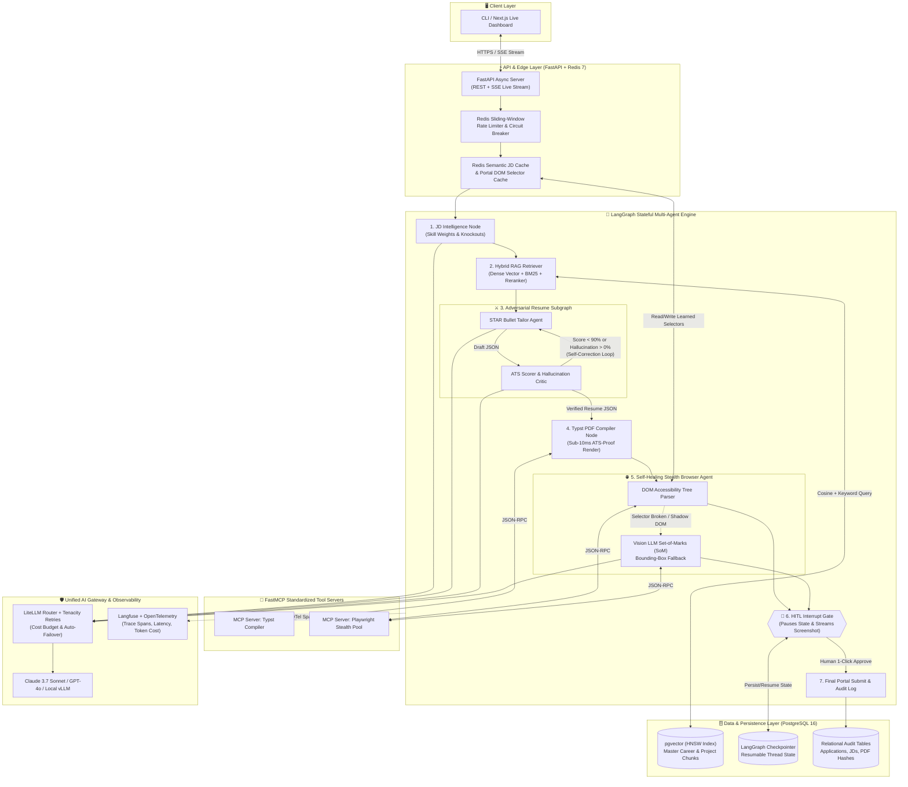

# ⚡ VanguardAI — Production System Architecture & Engineering Spec

> **Context Anchor for Engineers & AI Agents:** Always read this specification before generating or modifying any module. Build strictly one step at a time following Section 4.

---

## 1. High-Level Distributed System Architecture



---

## 2. Detailed Component & Data-Flow Specification

| Layer / Module | Technology | Exact Input Contract | Exact Output Contract | Production Failure Mode Prevented |
| :--- | :--- | :--- | :--- | :--- |
| **1. Config & Settings** | `pydantic-settings` | `.env` / OS Env Vars | Immutable `Settings` Singleton | Missing API keys crashing server mid-request |
| **2. AI Gateway** | `LiteLLM` + `Tenacity` | Prompt + `response_model` (Pydantic) | Validated Pydantic Object + Cost Metadata | Provider 429/503 outages, malformed JSON, token drain |
| **3. Hybrid RAG DB** | `PostgreSQL 16` + `pgvector` + `SQLAlchemy 2.0` | JD Embedding (`1536d`) + Keywords | Top-$K$ Ground-Truth Experience Chunks | Missing exact tech keywords or pulling irrelevant jobs |
| **4. Adversarial Graph** | `LangGraph` Subgraph | JD Requirements + RAG Chunks | Verified `TailoredResume` (`hallucination_score == 0.0`) | LLM inventing fake skills or failing ATS keyword filters |
| **5. PDF Compiler** | `FastMCP` + `Typst` | Verified `TailoredResume` JSON | Binary PDF + ATS Text Parse Verification | Slow HTML renders, broken margins, unreadable ATS layouts |
| **6. Browser Agent** | `FastMCP` + `Playwright` + Vision SoM | Job URL + PDF Path + User Profile | Filled Form State + Annotated Screenshot | Broken CSS selectors on Workday/Greenhouse/Lever |
| **7. HITL & API** | `FastAPI` + `LangGraph Checkpointer` | Thread ID + `HumanApproval(approved=True)` | SSE Live Stream + Final Submission Receipt | Accidental bad submissions or lost progress on crash |

---

## 3. Target Repository Structure (Built Progressively)

```text
vanguard-ai/
├── ARCHITECTURE.md                     # Permanent System Spec & AI Context Anchor
├── pyproject.toml                      # uv dependencies, ruff, mypy, pytest config
├── .env.example                        # 12-Factor environment template
├── Dockerfile                          # Multi-stage non-root production build
├── docker-compose.yml                  # App + Postgres 16 (pgvector) + Redis 7
├── .github/workflows/ci.yml            # Automated Lint, Type-check, Unit & Eval Gates
├── src/
│   └── vanguard/
│       ├── __init__.py
│       ├── config.py                   # [Milestone 1 - Step 1]
│       ├── schemas/
│       │   └── domain.py               # [Milestone 1 - Step 2]
│       ├── llm/
│       │   └── gateway.py              # [Milestone 1 - Step 3]
│       ├── db/
│       │   ├── session.py              # [Milestone 2 - Step 4]
│       │   ├── models.py               # [Milestone 2 - Step 4]
│       │   └── repository.py           # [Milestone 2 - Step 5]
│       ├── mcp/
│       │   ├── pdf_server.py           # [Milestone 2 - Step 6]
│       │   └── browser_server.py       # [Milestone 3 - Step 8]
│       ├── agents/
│       │   ├── state.py                # [Milestone 3 - Step 7]
│       │   ├── resume_subgraph.py      # [Milestone 3 - Step 7]
│       │   └── master_graph.py         # [Milestone 3 - Step 9]
│       ├── cache/
│       │   └── redis_client.py         # [Milestone 4 - Step 10]
│       ├── api/
│       │   └── main.py                 # [Milestone 4 - Step 11]
│       └── observability/
│           └── tracing.py              # [Milestone 4 - Step 12]
└── tests/
    ├── unit/                           # Mirrored unit tests for every single step
    └── evals/
        └── test_hallucination_gate.py  # [Milestone 4 - Step 12]
```

---

## 4. Progressive Engineering Roadmap (Strict 1-File-at-a-Time Rule)

### 🌱 Milestone 1: Core Foundation, Strict Contracts & Resilient AI Gateway
- [ ] **Step 1:** Workspace Packaging (`pyproject.toml`) & Type-Safe Config (`src/vanguard/config.py`)
- [ ] **Step 2:** Strict Domain & Adversarial Critic Schemas (`src/vanguard/schemas/domain.py`)
- [ ] **Step 3:** Multi-Provider LiteLLM Gateway with Retries & Budget Guards (`src/vanguard/llm/gateway.py`)

### 🔎 Milestone 2: Hybrid Vector Memory (`pgvector`) & Sub-10ms Typst PDF Server
- [ ] **Step 4:** Async SQLAlchemy 2.0 Engine & `pgvector` HNSW ORM Models (`src/vanguard/db/session.py`, `models.py`)
- [ ] **Step 5:** Hybrid Vector + Keyword Search Repository (`src/vanguard/db/repository.py`)
- [ ] **Step 6:** FastMCP Typst PDF Compiler Server (`src/vanguard/mcp/pdf_server.py`)

### 🤖 Milestone 3: Adversarial LangGraph & Self-Healing Browser Engine
- [ ] **Step 7:** Adversarial Resume Subgraph (Tailor ⇄ ATS Critic & Fact-Checker) (`src/vanguard/agents/resume_subgraph.py`)
- [ ] **Step 8:** Self-Healing Playwright + Vision Set-of-Marks MCP Server (`src/vanguard/mcp/browser_server.py`)
- [ ] **Step 9:** Master Orchestrator Graph with Postgres Checkpointing & HITL Interrupt (`src/vanguard/agents/master_graph.py`)

### 🌐 Milestone 4: Distributed Scale, Streaming API, Evals & CI/CD
- [ ] **Step 10:** Redis Portal-Selector Cache & Rate Limiter (`src/vanguard/cache/redis_client.py`)
- [ ] **Step 11:** FastAPI Async Server with SSE Live Streaming & HITL Resume Endpoint (`src/vanguard/api/main.py`)
- [ ] **Step 12:** Langfuse Tracing & Pytest LLM-as-a-Judge Anti-Hallucination Gate (`tests/evals/test_hallucination_gate.py`)
- [ ] **Step 13:** Production Docker Compose & GitHub Actions CI Pipeline (`Dockerfile`, `.github/workflows/ci.yml`)