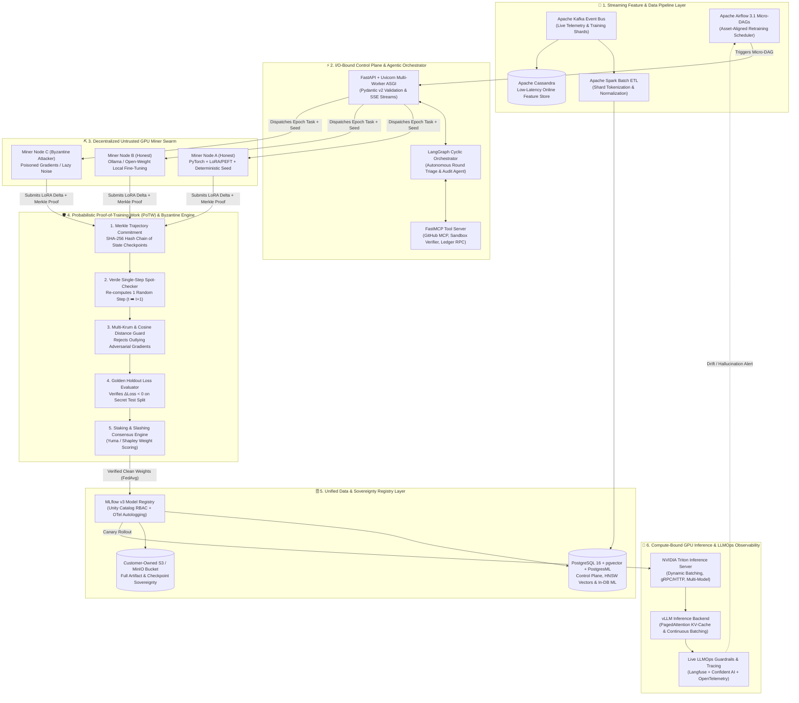

# ⚡ BigBind: Decentralized Proof-of-Training-Work (PoTW) & Enterprise MLOps Infrastructure

> **A Production-Grade Decentralized Training, Byzantine-Resilient Federated Learning, and High-Throughput Model Serving Platform** built on the **2026 MLOps Architectural Standards** (`LangGraph`, `FastMCP`, `FastAPI ASGI`, `NVIDIA Triton + vLLM`, `MLflow v3`, `Apache Airflow 3.1`, `PostgreSQL + pgvector + PostgresML`, `Apache Kafka`, and `OpenTelemetry + Langfuse`).

---

## 1. Executive Summary & Architectural Problem Statement

Training and fine-tuning foundation models (`LoRA / PEFT`) across distributed, untrusted GPU nodes over the open internet (Decentralized Physical Infrastructure Networks — **DePIN / DeAI**, inspired by *Gensyn* and *Bittensor*) introduces four critical production failure modes that standard MLOps pipelines cannot survive:

1. **The Compute Verification Asymmetry (Lazy / Free-Riding Miners):** Untrusted GPU worker nodes ("Miners") have a financial incentive to return random Gaussian noise or cached historical weights instead of executing expensive forward/backward propagation passes. Re-running 100% of the training epochs on a central validator node destroys the economic purpose of decentralized compute.
2. **Byzantine Model Poisoning & Backdoor Injection:** Malicious nodes can submit adversarial gradients engineered to skew decision boundaries or implant backdoor triggers while maintaining a normal L2 norm, corrupting naive `FedAvg` weight aggregation.
3. **The Python GIL & Workload Physics Bottleneck:** Serving both high-concurrency I/O coordination (node heartbeats, RAG lookups, agentic validation) and compute-bound GPU inference inside a single Python web framework causes severe thread starvation under the Global Interpreter Lock (GIL).
4. **Experiment Tracker Vendor Lock-In & Data Loss:** Relying on proprietary cloud experiment trackers without customer-owned object storage sovereignty risks catastrophic loss of historical run lineage and model checkpoints.

**BigBind** solves all four challenges through an end-to-end, cryptographically verifiable MLOps architecture.

---

## 2. End-to-End Distributed System Architecture

---

## 3. Deep Technical Specification of Core Modules

### 3.1 Streaming Data Engineering & Orchestration (`Kafka` + `Spark` + `Cassandra` + `Airflow 3.1`)
* **Event Streaming & Feature Serving:** Raw domain events and feedback logs stream through **Apache Kafka**. **Apache Spark** executes distributed batch preprocessing and deterministic shard hashing, while **Apache Cassandra** serves low-latency online features alongside **PostgreSQL**.
* **Modular Micro-DAGs (`Apache Airflow 3.1`):** Instead of brittle monolithic workflows, training rounds, drift checks, and weekly metadata exports are scheduled via **asset-aligned Airflow 3.1 micro-DAGs** (<10–50 tasks per DAG) with strict workspace isolation.

---

### 3.2 Probabilistic Proof-of-Training-Work (`PoTW`) & Deterministic Replay Protocol
To verify that a Miner genuinely executed $T$ gradient descent steps without re-running all $T$ steps on the Validator:

1. **Deterministic Execution Contract:** At the start of training round $r$, the Control Plane issues a cryptographically signed task manifest containing:
   * Base model checkpoint URI ($W_0$)
   * Dataset shard hash and deterministic mini-batch permutation seed ($s_r$)
   * Hyperparameters ($\eta$, batch size $B$, LoRA rank $k$, precision policy)
   * Forced deterministic CUDA/PyTorch flags (`torch.use_deterministic_algorithms(True)`)
2. **Intermediate Trajectory Checkpointing & Merkle Commitment:**
   * For a training epoch of $T = 100$ steps, the Miner records state snapshots every $m = 10$ steps: $\mathcal{C} = \{W_0, W_{10}, W_{20}, \dots, W_{100}\}$ along with step-level gradient norms and batch indices.
   * The Miner constructs a **SHA-256 Merkle Tree** over these snapshots and commits the `merkle_root` + final LoRA adapter weights $\Delta W_T$ to the Validator.
3. **Single-Step Probabilistic Spot-Check (*Verde Protocol*):**
   * The Validator uses a verifiable random function (VRF) to challenge $k=2$ random step intervals (e.g., step $t=40 \to 41$).
   * The Miner must provide the Merkle inclusion proof, checkpoint $W_{40}$, and checkpoint $W_{41}$.
   * The Validator loads $W_{40}$, feeds the exact deterministic mini-batch $x_{40}$ using seed $s_r$, and executes **a single forward/backward pass** to compute $\hat{W}_{41}$.
   * **Verification Condition:** The Validator checks bounded floating-point reproducibility:
     $$\frac{\|\hat{W}_{t+1} - W_{t+1}^{\text{miner}}\|_2}{\|\hat{W}_{t+1}\|_2} \le \epsilon_{\text{tol}}$$
   * Because the Miner cannot predict which step $t$ will be challenged before committing the `merkle_root`, faking even 10% of the steps results in an exponentially high probability of detection while costing the Validator only **1% of the compute**.

---

### 3.3 Byzantine-Resilient Aggregation (`Multi-Krum` + Cosine Guard + Holdout $\Delta \mathcal{L}$)
Passing the PoTW spot-check proves the Miner *ran PyTorch*, but does not prove the data was clean. Before merging weights into the global model:

1. **Pairwise Cosine Similarity Gate:** Computes cosine similarity between each Miner's flattened LoRA update vector $\Delta w_i$ and the median update vector. Updates with $\cos(\theta) < \tau_{\text{cos}}$ are flagged as anomalous.
2. **Multi-Krum Distance Scoring:** Given $n$ Miner submissions where up to $f$ nodes may be Byzantine attackers ($n > 2f + 2$), for each node $i$, the engine sums the squared Euclidean distances to its $n - f - 2$ closest neighbors:
   $$S(i) = \sum_{i \to j \in \mathcal{N}_{n-f-2}(i)} \|\Delta w_i - \Delta w_j\|_2^2$$
   Only the top $m$ updates with the lowest distance scores $S(i)$ are selected for **Coordinate-Wise Trimmed Mean / `FedAvg`** aggregation.
3. **Golden Holdout Evaluation & Economic Slashing:** The Validator evaluates candidate adapters against a secret **Golden Holdout Dataset** stored in `PostgreSQL`.
   * If $\mathcal{L}_{\text{holdout}}(W_0 + \Delta w_i) < \mathcal{L}_{\text{holdout}}(W_0)$, the Miner receives a **Yuma Consensus / Shapley contribution weight** and token reward.
   * If a Miner fails the Merkle Spot-Check, triggers the Byzantine filter, or degrades holdout loss beyond threshold, their staked collateral is **Slashed** on the ledger.

---

### 3.4 Agentic Governance & Standardized Tooling (`LangGraph` + `FastMCP`)
* **`LangGraph` Stateful Audit & Incident Orchestrator:** When an anomaly, Byzantine attack, or post-deployment drift spike occurs, a cyclic **LangGraph StateGraph** agent autonomously inspects the training trace, queries historical runs in `pgvector`, correlates hyper-parameter shifts, and pauses via a **Human-in-the-Loop (HITL)** interrupt before executing rollbacks or permanent node bans.
* **Anthropic Model Context Protocol (`FastMCP`):** All external agent actions—querying the **GitHub MCP Server** for code lineage, inspecting `MLflow` registries, or triggering `Triton` model reloads—are exposed through deterministic, schema-validated `FastMCP` tool servers.

---

### 3.5 Storage Sovereignty, Registry & In-Database ML (`MLflow v3` + `PostgreSQL` + `pgvector` + `PostgresML`)
Following the **2026 Storage Sovereignty Mandate** (preventing third-party SaaS data loss like the March 2026 Neptune.ai shutdown):
* **Self-Hosted `MLflow v3` + Customer-Owned `S3`:** All experiment metrics, `OpenTelemetry` traces, and `mlflow.genai.evaluate()` scores are backed by a single **PostgreSQL 16** control database, while all `.safetensors` / `ONNX` model weights are written directly to customer-owned **S3 / MinIO object storage** with automated weekly metadata dump/restore cron jobs.
* **Unified `PostgreSQL` + `pgvector` + `PostgresML`:** Eliminates microservice network hops by consolidating relational metadata, **HNSW vector indexing (`pgvector`)** for RAG memory, and low-latency **in-database inference (`PostgresML`)** inside a single PostgreSQL cluster.

---

### 3.6 Workload-Physics Serving Tier (`FastAPI ASGI` vs. `NVIDIA Triton` + `vLLM`)
In accordance with the **2026 Serving Architecture Standard**, BigBind strictly separates **I/O-bound** traffic from **GPU/compute-bound** inference:

| Tier | Technology Stack | Workload Physics | Performance & Protocol |
| :--- | :--- | :--- | :--- |
| **Control & API Gateway** | `FastAPI` + `Uvicorn` Multi-Worker `ASGI` + `Pydantic v2` | **I/O-Bound:** Node coordination, RAG retrieval, `LangGraph` orchestration, SSE streaming | **8,665 req/sec** at 500 concurrency (99th percentile latency: **116 ms** — **48.2x faster** than synchronous Flask WSGI) |
| **Dedicated GPU Inference** | `NVIDIA Triton Inference Server` + `vLLM` Backend | **Compute / GPU-Bound:** Bypassing Python's GIL for local neural network & LLM token generation | `HTTP/REST` & `gRPC` protocols, **PagedAttention** memory paging, **Continuous Batching**, and dynamic multi-model execution |
| **Live Production Eval & Tracing** | `Langfuse` + `Confident AI` + `OpenTelemetry` | **Real-Time Observability:** Live traffic hallucination detection, token cost tracking, and failing trace auto-curation | Asynchronous OTel span export with zero blocking impact on inference latency |

---

## 4. Progressive Implementation Roadmap (TDD + Agile GitHub Flow)

We build this system one module at a time using **Contract-First Design**, **Test-Driven Development (`pytest` Red ➡️ Green ➡️ Refactor)**, and **GitHub Issues/PRs**:

- [ ] **Step 1:** Workspace Packaging (`pyproject.toml`, `uv`, `ruff`, `mypy`) & GitHub Actions CI (`src/bigbind/config.py`)
- [ ] **Step 2:** Strict `Pydantic v2` Schemas for Task Manifests, Merkle Proofs & Gradient Submissions (`src/bigbind/schemas/domain.py`)
- [ ] **Step 3:** Cryptographic Merkle Tree & *Verde* Single-Step PoTW Spot-Check Verifier (`src/bigbind/potw/verifier.py`)
- [ ] **Step 4:** Deterministic `PyTorch` + `LoRA (PEFT)` Miner Training Node (`src/bigbind/training/miner.py`)
- [ ] **Step 5:** Byzantine Defense Engine (`Multi-Krum`, Cosine Guard & Coordinate Trimmed Mean) (`src/bigbind/training/aggregator.py`)
- [ ] **Step 6:** Economic Consensus, Staking Vault & Automated Slashing Ledger (`src/bigbind/ledger/consensus.py`)
- [ ] **Step 7:** Unified `PostgreSQL 16` + `pgvector` Repository & `MLflow v3` S3 Registry Client (`src/bigbind/db/registry.py`)
- [ ] **Step 8:** `FastMCP` Tool Server & `LangGraph` Autonomous Audit/Rollback Orchestrator (`src/bigbind/agents/audit_graph.py`)
- [ ] **Step 9:** High-Concurrency `FastAPI` + `Uvicorn` ASGI Gateway & `vLLM`/`Triton` Client (`src/bigbind/api/main.py`)
- [ ] **Step 10:** `Apache Airflow 3.1` Retraining Micro-DAG, `Langfuse` Tracing & `Docker Compose` Cluster (`docker-compose.yml`)

---

## 5. Complete Master Index of Skills, Tools & Benchmarks (Extracted from the 2026 Production AI & MLOps Infrastructure Report)

Every single skill, framework, database, cloud platform, and architectural pattern mentioned across all 18 pages of the **2026 Production AI and MLOps Infrastructure Report** is cataloged below and mapped into our engineering curriculum:

### A. Top 10 AI & MLOps Skill Clusters Ranked by US Median Compensation (Pages 2–6)
1. **Agent Orchestration (`LangGraph`, `Microsoft AutoGen`, `CrewAI`):**
   * **Market Metrics:** **$209,500** median base salary ($160,000–$271,250 IQR); +280% YoY job growth (~90,000 listings); 13% engineer adoption (scarcity overrides seniority).
2. **LLM Application Development (`LangChain`, `LlamaIndex`):**
   * **Market Metrics:** **$200,000** median (`LangChain`, 20% adoption, $150k–$250k IQR) vs. **$174,000** median (`LlamaIndex`); 4x LLM job growth.
3. **Managed Cloud AI Platforms & Multi-Provider Routing (`AWS` / `Amazon Bedrock Agents`, `GCP` / `Google Vertex AI`, `Microsoft Azure`, `OpenRouter`):**
   * **Market Metrics:** **$200,000** median (`Bedrock Agents`, starts at $132,500); **$185,000** (`OpenRouter` multi-provider routing); **$181,954** (`Vertex AI`, $130k–$250k); **$145,500** (`Azure`). Cloud adoption share: **AWS (47%)**, **GCP (29%)**, **Azure (23%)**.
4. **Vector Search & In-Database ML (`PostgreSQL`, `pgvector`, `PostgresML`):**
   * **Market Metrics:** **$191,500** median salary; consolidates relational metadata, `pgvector` RAG indexing, and `PostgresML` in-database training/fine-tuning/inference without microservice network hops.
5. **Enterprise Data Platforms for AI (`Snowflake`, `Databricks`, `AWS SageMaker`, `Unity Catalog`):**
   * **Market Metrics:** **$190,000** median salary; centralized feature governance, training data lineage, and Role-Based Access Control (`RBAC`).
6. **AI Coding Agents & Standardized Tool Protocols (`Claude Code`, `Anthropic Model Context Protocol / MCP`, `GitHub MCP Server`):**
   * **Market Metrics:** **$183,500** median (`Claude Code`) and **$180,000** median (`GitHub MCP Server`).
7. **MLOps & Container Infrastructure (`Kubernetes`, `Docker`, `Kubeflow`, `Infrastructure-as-Code / IaC`):**
   * **Market Metrics:** **$180,000** median (`Kubernetes`, appears in 17.6% of UK AI postings); `Docker` profile mentions surged **+178% YoY**.
8. **Open-Weight Models & Local Inference (`Ollama`, `PyTorch`, `TensorFlow`, `scikit-learn`):**
   * **Market Metrics:** **$176,800** median (`Ollama`); driven by local inference, privacy compliance, and cost optimization. Organizational adoption: `PyTorch` (78,759 orgs), `TensorFlow` (77,043 orgs), `scikit-learn` (48,867 orgs).
9. **Core Backend & Systems Programming (`Python`, `Java`, `SQL`, `NoSQL`, `Graph Databases`, `Time Series Databases`, `JavaScript`):**
   * **Market Metrics:** **$160,000** median (`Python` universal baseline); `Java` (21% of ML postings) and `SQL` (18%) power low-latency corporate microservice integration.
10. **Foundational Data Science (`Data Scientist`):**
    * **Market Metrics:** **$137,000** median (commoditized relative to production deployment and distributed infrastructure engineering).

---

### B. Core AI Modeling & Machine Learning Techniques (Page 7)
* **Natural Language Processing (`NLP`):** 19.7% of ML job postings
* **Computer Vision (`CV`):** 14.9%
* **Model Fine-Tuning (`LoRA`, `PEFT`, `QLoRA`):** 10.0%
* **Retrieval-Augmented Generation (`RAG`):** 7.2%
* **Artificial Neural Networks (`ANN` / Deep Learning):** 6.8%
* **Reinforcement Learning (`RL`):** 6.4%
* **Autonomous `AI Agents`:** 6.4%
* **Statistical `Anomaly Detection`:** 3.0%
* **Time-Series `Forecasting & Business Intelligence (BI)`:** 2.5%
* **Reinforcement Learning from Human Feedback (`RLHF`):** 2.3%

---

### C. Data Engineering, Streaming & Pipeline Orchestration Skills (Pages 6–8, 14–16)
* **Distributed Batch Compute:** `Apache Spark` (15.0% of ML job postings) & `Big Data` processing (10.6%)
* **Data Pipelines & `ETL Workflows`:** 14.5% of job postings (+166% YoY growth on LinkedIn)
* **Real-Time Event Streaming:** `Apache Kafka` / Stream Processing (+125% YoY growth across banking, capital markets, and healthcare)
* **Low-Latency Online Feature Store:** `Apache Cassandra` (paired with PostgreSQL offline control planes)
* **Continuous Deployment (`CD` for ML):** 10.5% of ML job postings
* **Workflow Orchestration (`Apache Airflow 3.0–3.1`):**
  * Covers ~80% of MLOps job listings when paired with `Python`, `Docker`, `Kubernetes`, and `MLflow`.
  * **Key 2026 Patterns:** Modular, asset-aligned **micro-DAGs** (<10 to 50 tasks), multi-instance workspace isolation, AI-assisted DAG authoring, and automated GenAI RAG / retraining pipelines.

---

### D. Model Serving & API Boundary Technologies (Pages 8–11, 15)
* **`FastAPI` + `Uvicorn` (`ASGI` / `asyncio`):**
  * **42%** ML engineer adoption (surpassing `Flask` at 28% and `Django` at 22%; 88,000+ GitHub stars, 9M monthly PyPI downloads).
  * Native `Pydantic` schema validation, automatic `Swagger/OpenAPI` docs, non-blocking I/O concurrency (**8,665.48 req/s** vs. `Flask WSGI`'s 27.82s bottleneck).
  * **Architectural Boundary:** Strictly scoped to I/O-bound orchestration, validation, and RAG gateways; must use multi-process worker pools and avoid compute-bound local inference due to Python's **Global Interpreter Lock (`GIL`)** and high-RPS memory leak risks.
* **`NVIDIA Triton Inference Server`:**
  * Multi-framework heterogeneous GPU serving (`CV`, tabular, `LLMs`), **dynamic batching**, concurrent model execution, standardized `HTTP/REST` and `gRPC` protocols, centralized enterprise governance, and `MLPerf`-validated throughput.
* **`vLLM` (High-Throughput LLM Serving Engine):**
  * Dedicated LLM token serving via **PagedAttention** memory paging and **continuous batching**, exposing OpenAI-compatible API endpoints (frequently deployed as a specialized backend inside `NVIDIA Triton`).
* **`Flask (WSGI)` & `Django`:**
  * Retained selectively for lightweight synchronous RPC microservices (`Flask`) or full-stack apps requiring built-in ORM, auth, and admin dashboards (`Django`).

---

### E. Experiment Tracking, Model Registry, Storage Sovereignty & Live LLMOps Evals (Pages 11–14)
* **`MLflow (v3)`:**
  * Deployed by **22,924 organizations** (Apache 2.0 Open Source, Linux Foundation / Databricks).
  * **2026 Features:** Full data sovereignty (`PostgreSQL` metadata DB + customer-owned `AWS S3` / `Google Cloud Storage` / `Azure Blob` buckets with native dump/restore), `Unity Catalog RBAC`, autologging, `OpenTelemetry (OTel)` tracing, and `mlflow.genai.evaluate()`.
* **`Weights & Biases (W&B / CoreWeave Forge)` & `W&B Weave`:**
  * Best-in-class UI for comparing hundreds of concurrent frontier loss curves and automated parallel hyperparameter sweeps; requires **BYO-bucket** (`customer-owned S3`) and automated weekly `scan_history()` cron exports to prevent vendor lock-in.
* **`Comet` & `ClearML`:**
  * Alternative experiment trackers (with note on `Neptune.ai`'s March 2026 shutdown after OpenAI acquisition as the case study for enforcing **Storage Sovereignty**).
* **Live Production GenAI Evaluation & Observability Platforms:**
  * `Langfuse`, `Confident AI`, `Arize AI`, `LangWatch`, and `LangSmith` layered on top of model registries to detect live production hallucinations and auto-curate failing traces into golden evaluation datasets.