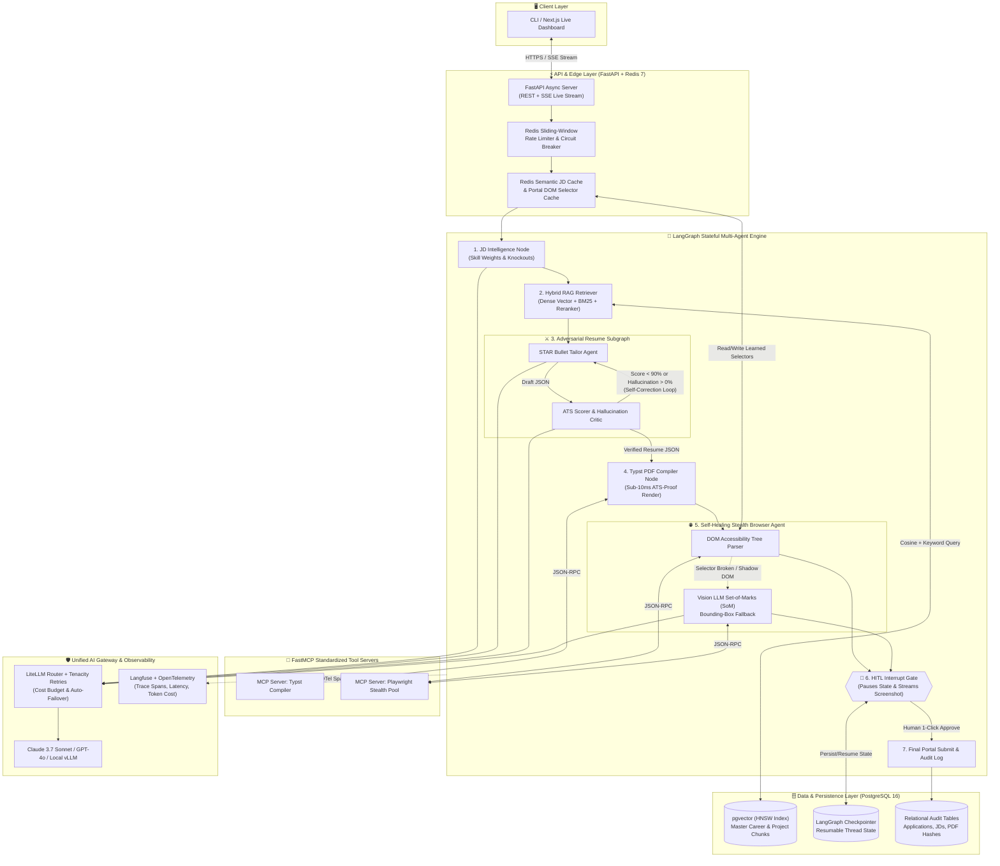

# ⚡ VanguardAI

> **Autonomous, Anti-Hallucinatory Agentic Career Copilot & Stealth Application Engine**  
> Built from scratch with Python 3.12+, LangGraph, FastMCP, PostgreSQL 16 (`pgvector`), Redis 7, and LiteLLM.

---

## 🏛️ System Architecture

---

## 📊 Live Engineering Progress Tracker

All steps are built following **strict Test-Driven Development (TDD)** and **Agile GitHub Flow**.  
Real-time session state is tracked in [`PROGRESS.md`](PROGRESS.md) and full technical specs in [`ARCHITECTURE.md`](ARCHITECTURE.md).

### 🌱 Milestone 1: Core Foundation, Strict Contracts & Resilient AI Gateway
| Step | Component | Technology | Target File | Issue | Status |
| :---: | :--- | :--- | :--- | :---: | :---: |
| **01** | Workspace Packaging & Type-Safe Config | `uv`, `pydantic-settings` | `src/vanguard/config.py` | [#1](#) | 🟡 **In Progress** |
| **02** | Strict Domain & Critic Schemas | `Pydantic v2` | `src/vanguard/schemas/domain.py` | — | ⏳ Queued |
| **03** | Resilient Multi-Provider AI Gateway | `LiteLLM`, `Tenacity` | `src/vanguard/llm/gateway.py` | — | ⏳ Queued |

### 🔎 Milestone 2: Hybrid Vector Memory & Typst PDF Server
| Step | Component | Technology | Target File | Status |
| :---: | :--- | :--- | :--- | :---: |
| **04** | Async ORM Engine & `pgvector` Models | `SQLAlchemy 2.0`, `pgvector` | `src/vanguard/db/session.py` | ⏳ Queued |
| **05** | Hybrid Dense + Keyword Search Repository | `pgvector` HNSW, Reciprocal Rank Fusion | `src/vanguard/db/repository.py` | ⏳ Queued |
| **06** | Sub-10ms Typst PDF Compiler MCP Server | `FastMCP`, `Typst` | `src/vanguard/mcp/pdf_server.py` | ⏳ Queued |

### 🤖 Milestone 3: Adversarial LangGraph & Self-Healing Browser Engine
| Step | Component | Technology | Target File | Status |
| :---: | :--- | :--- | :--- | :---: |
| **07** | Adversarial Tailor ⇄ Critic Subgraph | `LangGraph` Subgraph | `src/vanguard/agents/resume_subgraph.py` | ⏳ Queued |
| **08** | Self-Healing Stealth Browser MCP Server | `Playwright`, Vision SoM | `src/vanguard/mcp/browser_server.py` | ⏳ Queued |
| **09** | Master Graph with Checkpoints & HITL Gate | `LangGraph Checkpointer` | `src/vanguard/agents/master_graph.py` | ⏳ Queued |

### 🌐 Milestone 4: Distributed Scale, Streaming API & Production CI/CD
| Step | Component | Technology | Target File | Status |
| :---: | :--- | :--- | :--- | :---: |
| **10** | Redis Rate Limiter & Portal Selector Cache | `Redis 7` | `src/vanguard/cache/redis_client.py` | ⏳ Queued |
| **11** | FastAPI Async Server with SSE Stream & HITL | `FastAPI`, `SSE` | `src/vanguard/api/main.py` | ⏳ Queued |
| **12** | Langfuse Tracing & Pytest LLM-as-a-Judge Eval | `Langfuse`, `pytest` | `tests/evals/test_hallucination_gate.py` | ⏳ Queued |
| **13** | Production Multi-Stage Docker & CI/CD Gate | `Docker`, GitHub Actions | `.github/workflows/ci.yml` | ⏳ Queued |

---

## 🛠️ Tech Stack & Engineering Standards
- **Python 3.12+** with zero untyped code (`mypy --strict`).
- **TDD First:** Every single feature starts with a red `pytest` suite before production code is written.
- **Contract-First:** All API payloads and agent messages are enforced by immutable Pydantic v2 schemas.
- **Agile GitHub Flow:** Every change has an Issue, branch, conventional commit, and CI-gated Pull Request.

---

## 📄 License
MIT © [M. Hesam Moradian](https://github.com/m-hesam-moradian)
