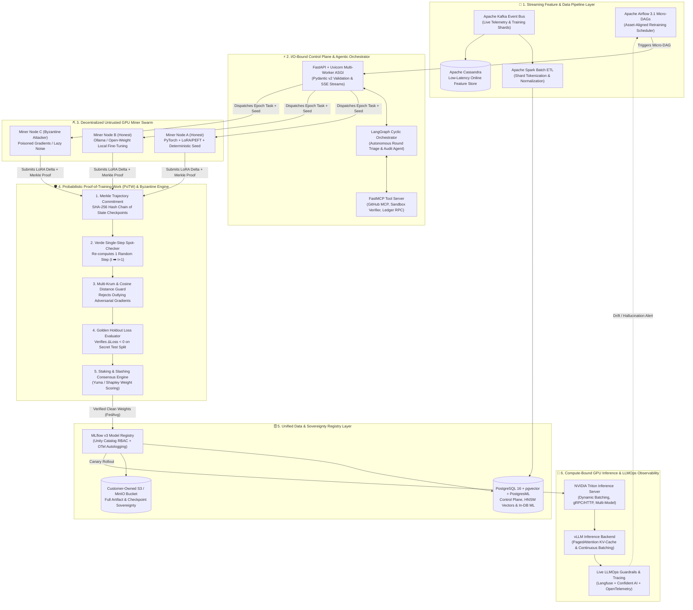

# ⚡ veritasnet

> **Decentralized Proof-of-Training-Work (PoTW) & Enterprise MLOps Infrastructure**  
> A Production-Grade Decentralized Training, Byzantine-Resilient Federated Learning, and High-Throughput Model Serving Platform built on **2026 MLOps Architectural Standards**.

---

## 🏛️ System Architecture

---

## 📊 Live Engineering Progress Tracker

All steps are built following **strict Test-Driven Development (TDD)** and **Agile GitHub Flow**.  
Real-time session state is tracked in [`PROGRESS.md`](PROGRESS.md) and full technical specs in [`ARCHITECTURE.md`](ARCHITECTURE.md).

### 🌱 Milestone 1: Core Foundation, Verifiable Contracts & PoTW Engine
| Step | Component | Technology | Target File | Issue | Status |
| :---: | :--- | :--- | :--- | :---: | :---: |
| **01** | Workspace Packaging & Type-Safe Config | `uv`, `pydantic-settings` | `src/veritasnet/config.py` | [#1](#) | 🟡 **In Progress** |
| **02** | Strict Pydantic v2 Task Manifests & Merkle Schemas | `Pydantic v2` | `src/veritasnet/schemas/domain.py` | — | ⏳ Queued |
| **03** | Cryptographic Merkle Tree & Verde Spot-Check Verifier | `hashlib`, `Cryptography` | `src/veritasnet/potw/verifier.py` | — | ⏳ Queued |

### ⛏️ Milestone 2: Deterministic Mining, Byzantine Defense & Economic Ledger
| Step | Component | Technology | Target File | Status |
| :---: | :--- | :--- | :--- | :---: |
| **04** | Deterministic PyTorch + LoRA Miner Training Node | `PyTorch`, `PEFT` | `src/veritasnet/training/miner.py` | ⏳ Queued |
| **05** | Byzantine Defense Engine (Multi-Krum + Cosine Guard) | `NumPy`, `SciPy` | `src/veritasnet/training/aggregator.py` | ⏳ Queued |
| **06** | Economic Consensus, Staking Vault & Slashing Ledger | `Yuma / Shapley Consensus` | `src/veritasnet/ledger/consensus.py` | ⏳ Queued |

### 🗄️ Milestone 3: Storage Sovereignty & Agentic Governance
| Step | Component | Technology | Target File | Status |
| :---: | :--- | :--- | :--- | :---: |
| **07** | PostgreSQL 16 + pgvector & MLflow v3 S3 Registry Client | `SQLAlchemy 2.0`, `pgvector`, `MLflow v3` | `src/veritasnet/db/registry.py` | ⏳ Queued |
| **08** | FastMCP Tool Server & LangGraph Autonomous Audit Agent | `FastMCP`, `LangGraph` | `src/veritasnet/agents/audit_graph.py` | ⏳ Queued |

### 🚀 Milestone 4: High-Concurrency Serving, Airflow & Production Deployment
| Step | Component | Technology | Target File | Status |
| :---: | :--- | :--- | :--- | :---: |
| **09** | High-Concurrency FastAPI ASGI Gateway & Triton/vLLM Client | `FastAPI`, `Uvicorn`, `Triton Client` | `src/veritasnet/api/main.py` | ⏳ Queued |
| **10** | Apache Airflow 3.1 Retraining Micro-DAG & Docker Cluster | `Airflow 3.1`, `Langfuse`, `Docker Compose` | `docker-compose.yml` | ⏳ Queued |

---

## 🛠️ Tech Stack & Engineering Standards
- **Python 3.12+** with zero untyped code (`mypy --strict`).
- **TDD First:** Every single feature starts with a red `pytest` suite before production code is written.
- **Contract-First:** All API manifests, Merkle state proofs, and agent tools are enforced by immutable Pydantic v2 schemas.
- **Storage Sovereignty:** Customer-owned S3 object buckets and self-hosted PostgreSQL/MLflow clusters—zero proprietary cloud lock-in.
- **Workload Physics Separation:** I/O-bound coordination (`FastAPI ASGI`) strictly separated from GPU-bound inference (`NVIDIA Triton` + `vLLM`).
- **Agile GitHub Flow:** Every change has a GitHub Issue, feature branch, conventional commit, and CI-gated Pull Request.

---

## 📄 License
MIT © [M. Hesam Moradian](https://github.com/m-hesam-moradian)
